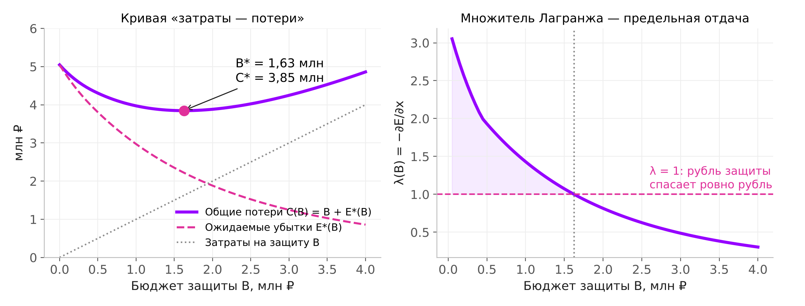

# Оценка стоимости информационных атак и защиты (Вариант 5)

Проект по математическому анализу (3 семестр, направление «Информационная безопасность»).
Применение кратных интегралов и метода Лагранжа для поиска оптимального уровня затрат на защиту ИС стоимостью 10 млн ₽.

## Главный результат

| Показатель | Значение |
|---|---|
| Оптимальный бюджет защиты B* | **1,63 млн ₽** |
| из них предотвращение / обнаружение | 0,99 / 0,64 млн ₽ |
| Общие потери (убытки + затраты) | 3,85 млн ₽ против 5,05 без защиты (−24 %) |



## Модель

- Вероятность успешной атаки: `P = exp(−a·x₁·(1−q))`, q — квалификация злоумышленника, q ~ Beta(2,2)
- Окно до обнаружения: `t ~ U[0, T(x₂)]`, `T(x₂) = T₀ / (1 + b·x₂)`
- Убыток: `L = V·(1 − exp(−g·q·t))`
- Ожидаемые убытки — двойной интеграл с переменной границей:
  `E(x₁,x₂) = ∫₀¹ ∫₀^{T(x₂)} P·L·f(q)·(1/T) dt dq`
- Цель: `C = x₁ + x₂ + E(x₁,x₂) → min`; условие оптимума по Лагранжу: `λ(B*) = 1`

Параметры (учебные): V = 10 млн ₽, a = b = 1,2, g = 0,04 1/день, T₀ = 90 дней.

## Состав репозитория

| Файл | Назначение |
|---|---|
| `project_team_N.ipynb` | Основной ноутбук: бриф, технический минимум, данные, расчёт, визуализация, границы применимости и модели |
| `interactive_budget.html` | Интерактивный график со слайдером квалификации злоумышленника (открывается в браузере) |
| `attacks_synthetic.csv` | Синтетические данные: 20 000 атак (q, u) для проверки интеграла методом Монте-Карло |
| `presentation_variant5.pptx` | Презентация на шаблоне ИТМО, текст для озвучки — в заметках к слайдам |
| `figures/` | Графики для отчёта и слайдов |
| `scripts/` | Скрипты сборки ноутбука, графиков и презентации |

## Запуск

```bash
pip install -r requirements.txt
jupyter notebook project_team_N.ipynb   # Kernel → Restart & Run All
```

Ноутбук запускается «с нуля» и сам генерирует `attacks_synthetic.csv` и `interactive_budget.html`.

## Ограничения

Данные синтетические, параметры учебные; выводы не заменяют аудит ИБ. Подробно — раздел «Границы модели» в ноутбуке.
